

# Oxbench

**A fast, native developer workbench: databases, API client, SSH, Docker and schema tools in one app.**

Written in Rust. Starts in under a second, idles at ~35 MB of RAM, ships as a single installer.

&nbsp;

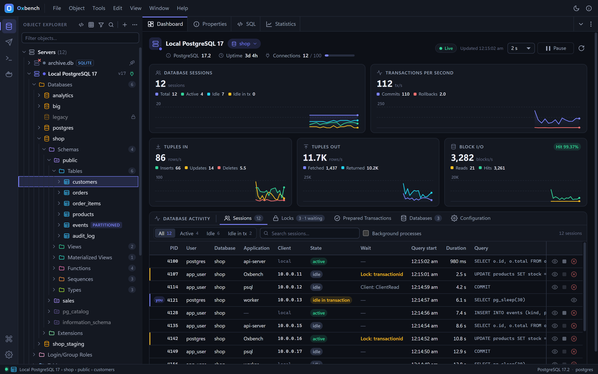

---

## Why Oxbench

Developers juggle five tools: a database GUI, an API client, an SSH client, a Docker dashboard and a diagramming tool, each a few hundred megabytes of Electron or Python. Oxbench puts them in one native window with the same look, the same keyboard shortcuts and one command palette, and keeps every secret in the OS keychain.

| | |
|---|---|
| ⚡ **Native speed** | Rust core, system WebView, no bundled browser or runtime. Cold start < 1 s. |
| 🗄️ **Five database engines** | PostgreSQL, MySQL / MariaDB, SQLite, Redis / Valkey and MongoDB, each with the tools it deserves. |
| 🔌 **API client** | Collections, environments, cookie jar, code generation, Postman and cURL import. |
| 🖥️ **SSH & terminal** | Host vault, tabs and split panes, SFTP, port forwarding, keys, X11. |
| 🐳 **Docker** | Containers, logs, stats, shells, images, volumes, networks, and a Dockerfile Builder. |
| 🧩 **Schema tools** | ER diagrams and schema diff with migration SQL. |
| 🔒 **Secure by default** | Passwords, tokens and passphrases live in Windows Credential Manager, never in config files. Destructive actions are confirmed in the Rust core. |

---

## Download

**[⬇ Oxbench 0.8.1 for Windows (x64)](https://github.com/gautamrampal/oxbench/releases/latest/download/Oxbench_0.8.1_x64-setup.exe)** — installs for the current user, no admin rights needed. An MSI package is on the [releases page](https://github.com/gautamrampal/oxbench/releases/latest).

- Windows 10 / 11, 64-bit. The installer adds the WebView2 runtime if it is missing (Windows 11 already has it).
- The binary is not code-signed yet, so Windows SmartScreen may show "Windows protected your PC". Click **More info → Run anyway**.
- Linux and macOS builds are planned (see [Roadmap](#roadmap)).

---

## Features

### Databases

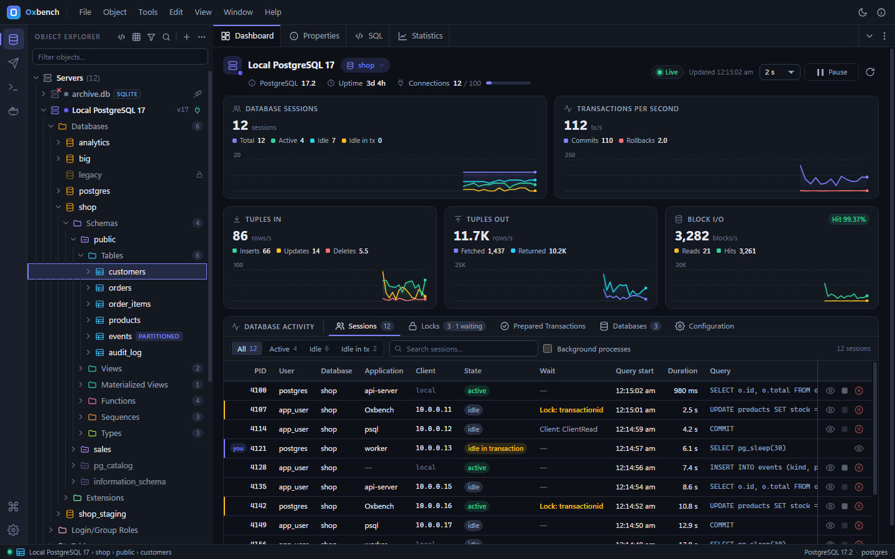

- **Object Explorer** for PostgreSQL, MySQL / MariaDB, SQLite, Redis and MongoDB: servers, databases, schemas, tables, views, functions, sequences, types, roles, extensions, keys, collections and indexes. Filter, keyboard navigation, context menus, Search Objects.
- **Properties / SQL / Statistics** panels with reconstructed DDL for every object.
- **Dashboard**: live sessions, transactions per second, tuples, block I/O, locks and database sizes, with cancel and terminate (PostgreSQL and MySQL / MariaDB; a file overview for SQLite).
- **Create / drop / maintain**: Create Database, Schema and Table dialogs with a live SQL tab, drop with CASCADE, truncate, VACUUM / ANALYZE / REINDEX, backup and restore through `pg_dump` / `pg_restore`, MySQL users and privileges.
- **SSH tunnels** for every engine through a host saved in the SSH workspace.

### Query Tool

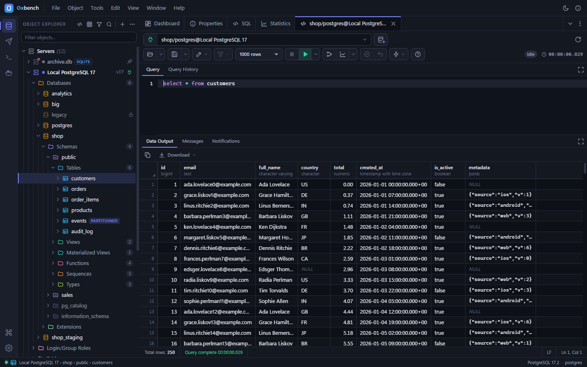

- Multiple tabs, one connection each, so transactions stay isolated.
- SQL editor with highlighting, schema-aware autocomplete, formatting, comment toggle and macros.
- Multi-statement scripts with multiple result sets, NOTICE messages, cancel, transaction status with Commit / Rollback, auto-commit and auto-rollback options, row limits, history, scratch pad, LISTEN / NOTIFY notifications.
- Open and save `.sql`, export results as CSV or JSON.

### Explain plans

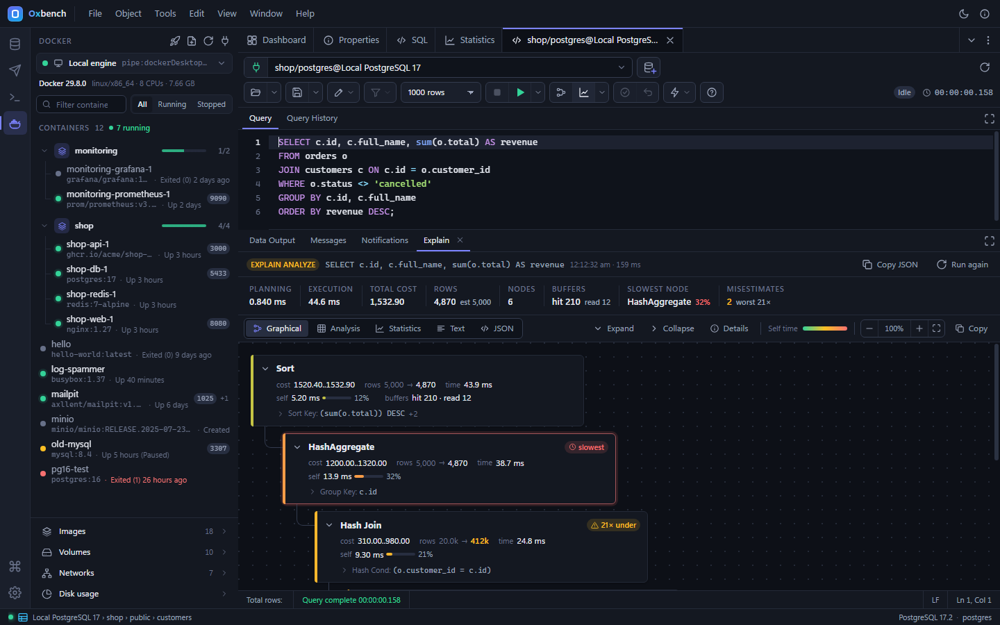

EXPLAIN and EXPLAIN ANALYZE as a graphical plan tree with cost and time heat, row-estimate warnings and the slowest node highlighted, plus text and JSON views.

### Data editor

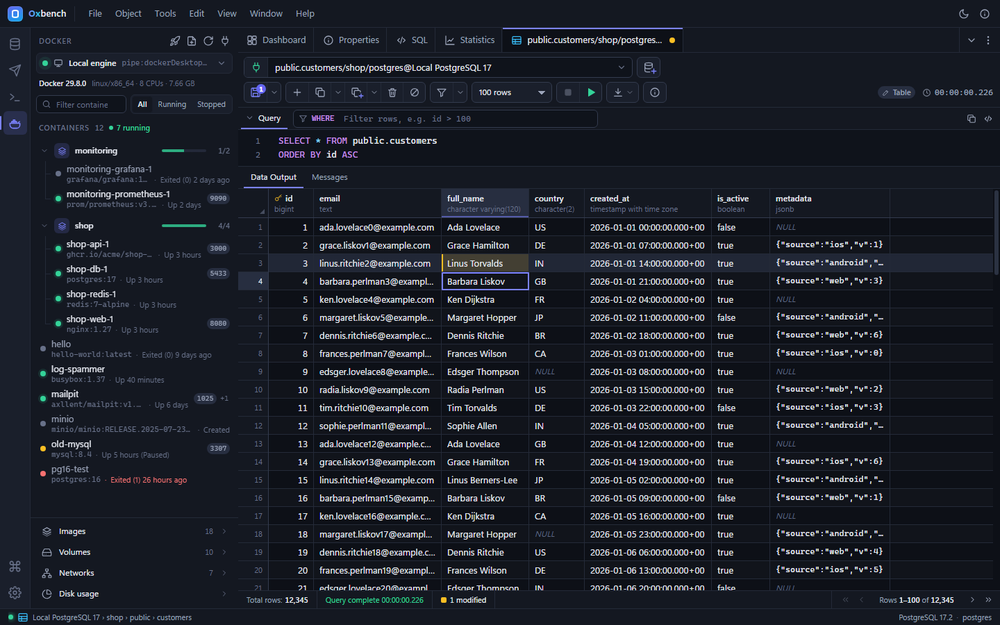

A paged, virtualized grid that stays smooth at 100,000 rows. Server-side sort and WHERE filter, inline editing, insert and delete rows, an SQL preview before every save, all applied in one transaction.

### ER diagram

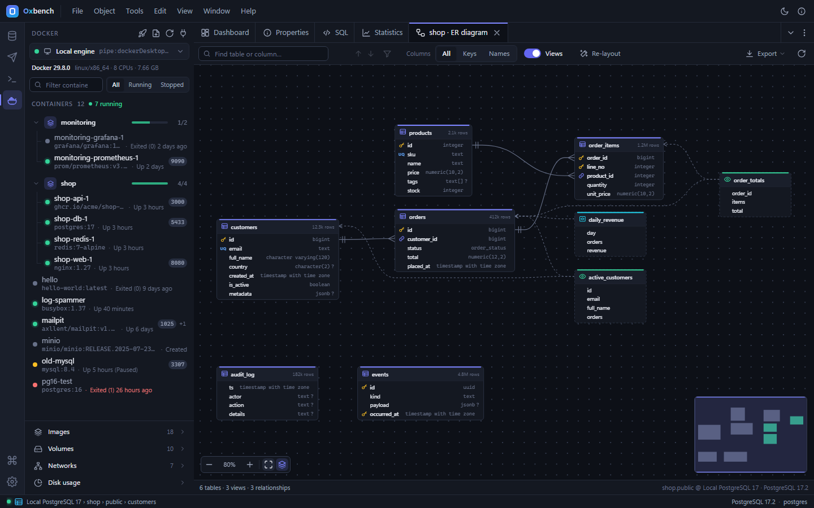

Tables as cards with keys and types, foreign keys as crow's-foot relationships, automatic layout for hundreds of tables, pan, zoom and a minimap, draggable cards that remember their place, filters, and SVG / PNG export. PostgreSQL, MySQL / MariaDB and SQLite.

### Schema diff

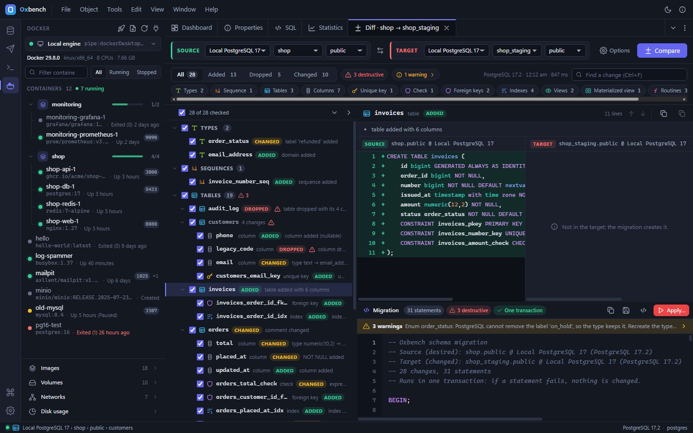

Compare two databases of the same engine (the servers may differ). A tree of changes with a side-by-side DDL diff, and migration SQL for the changes you tick, in a dependency-safe order. Copy it, save it, open it in the Query Tool, or apply it behind a typed confirmation. SQLite table rebuilds are handled for you.

### Redis / Valkey

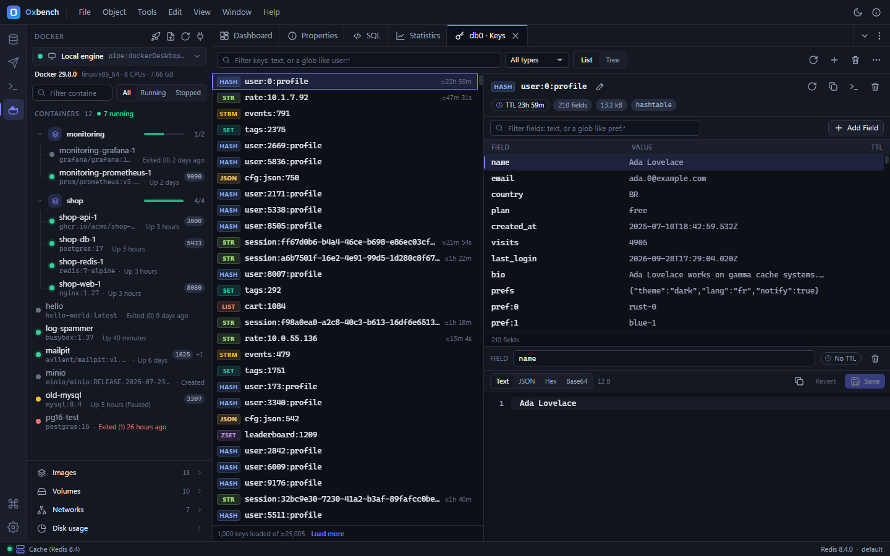

Key Browser with incremental SCAN, namespace tree and bulk delete with a dry run; viewers and compare-and-swap editors for strings, hashes, lists, sets, sorted sets, streams and JSON; a redis-cli style console with pub/sub and MONITOR panes; Server Info with live tiles, slowlog, clients, editable config and an ACL editor; keyspace events; a Lua / Functions script editor; key import / export; Sentinel with failover.

### MongoDB

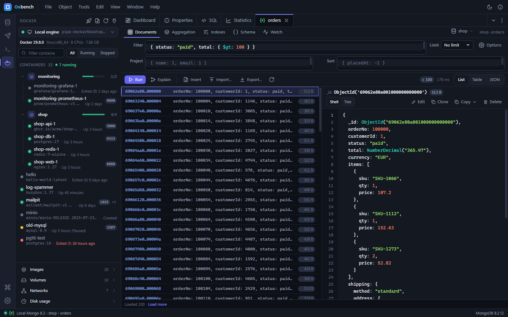

Documents in List, Table and JSON views with live-validated filter, projection and sort; a typed document editor with conflict detection; aggregation stage cards with per-stage previews; indexes; explain; a mongosh-style shell; change streams; schema analysis; users and roles; import and export of JSON Lines, JSON and CSV.

### API client

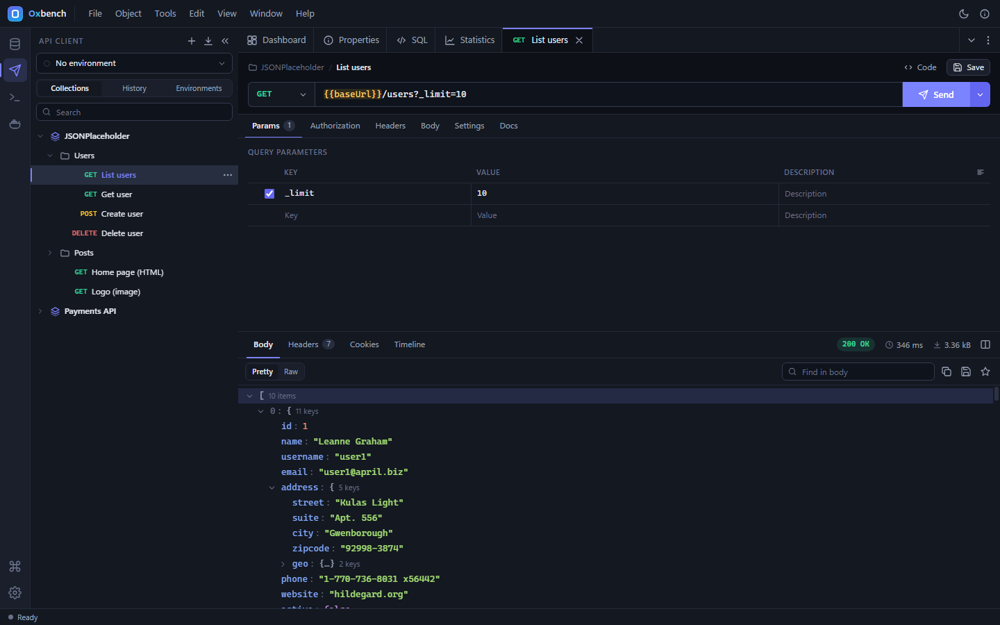

Requests with params, path variables, headers, every body type (JSON, XML, text, form, multipart, binary, GraphQL) and Basic / Bearer / API-key auth. JSON tree, raw, HTML preview and timeline views. Collections stored as git-friendly files, environments and globals with secrets in the keychain, history, cookie jar, Postman and cURL import, code generation in 14 languages.

### SSH & terminal

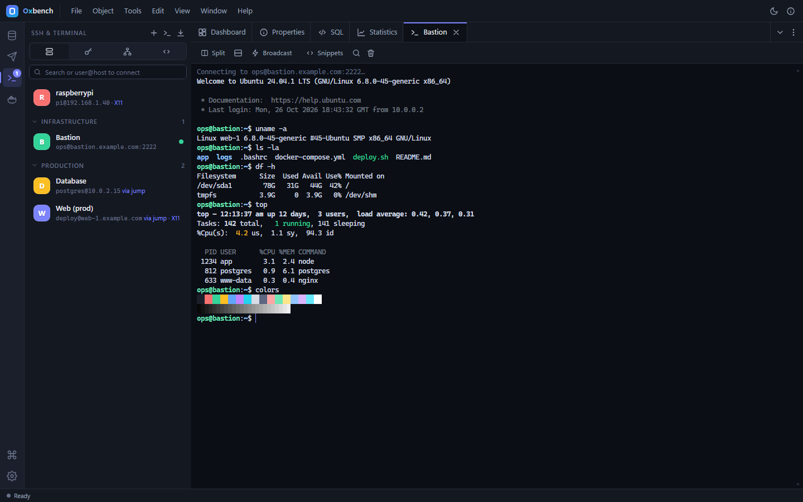

A host vault with groups, tags, jump hosts and `~/.ssh/config` import; password, key, agent and keyboard-interactive auth; host-key verification; terminals with split panes, broadcast, search and snippets; local shells (PowerShell, cmd, Git Bash, WSL); a two-pane SFTP browser with drag and drop; Ed25519, RSA and ECDSA key generation; local, remote and SOCKS5 port forwarding; X11 forwarding.

### Docker

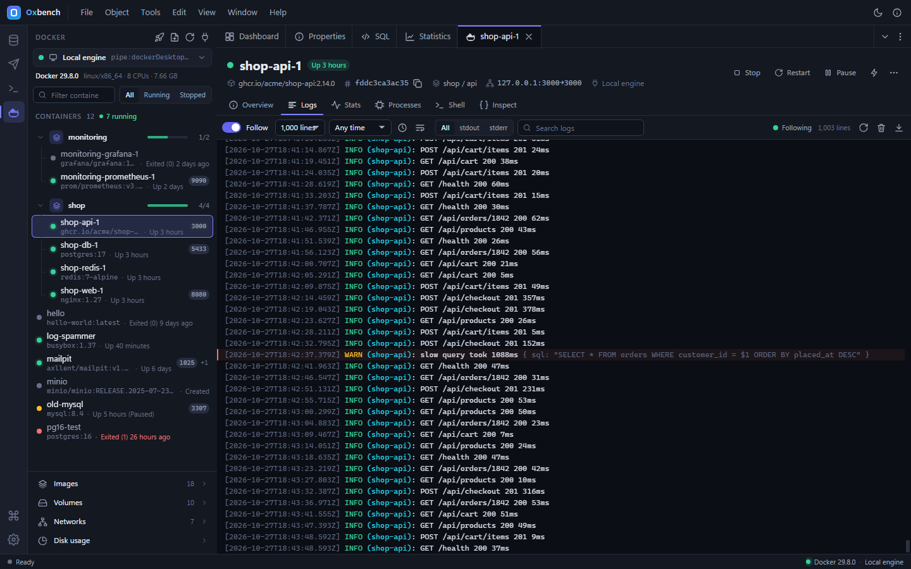

The local engine is found by itself; add TCP / TLS engines too. Containers grouped by compose project with start, stop, restart, pause, kill, remove and rename; a container tab with Overview, Logs (follow and search), live Stats charts, Processes, Shell and Inspect. Images with pull progress, volumes, networks, disk usage. **Quick launch** a PostgreSQL, MySQL, MariaDB, Redis or MongoDB container that registers itself in the Databases workspace.

### Dockerfile Builder

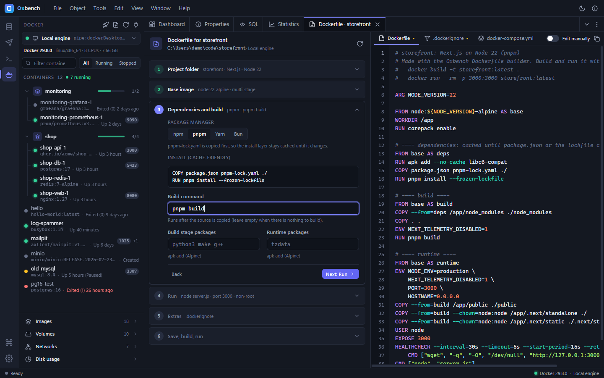

Point it at a project folder. It detects the stack (Node.js and static sites, Python, Go, Rust, Java, .NET, PHP) and explains why, walks you through base image, dependencies, build, run and extras, and previews the Dockerfile, `.dockerignore` and `docker-compose.yml` as you answer. Then save, build with live step progress, and run the container.

### Light theme, command palette, keyboard first

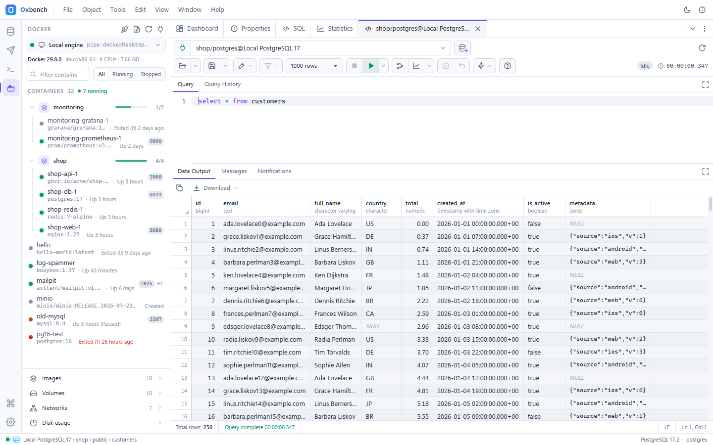

Dark and light themes, a command palette (Ctrl+K), workspace shortcuts (Ctrl+Shift+1…4), resizable panes, draggable tabs, and a shortcut for every main action (F1 lists them).

---

## Roadmap

| Status | Release | What |
|---|---|---|
| ✅ | 0.1 – 0.5 | PostgreSQL workbench, API client, SSH & terminal, MySQL / MariaDB & SQLite, Redis & MongoDB |
| ✅ | 0.6 | Engine parity: MySQL / SQLite tools, Redis and MongoDB administration, SSH keys and X11 |
| ✅ | 0.7 | Schema tools: ER diagram and schema diff |
| ✅ | 0.8 | Docker workspace and Dockerfile Builder |
| ⏳ | 0.9 | Dev tools: JSON / YAML / CSV / XML, JWT, Base64, hashes, UUID, timestamps, cron, regex, diff, colour… |
| ⏳ | 0.10 | API client, advanced: scripts, collection runner, OAuth 2.0, GraphQL explorer, OpenAPI import |
| ⏳ | 0.11 | Realtime: WebSocket and SSE clients, mock server, load testing |
| ⏳ | 0.12 | Kafka |
| ⏳ | 0.13 | gRPC |
| ⏳ | — | Linux (`.deb`, AppImage) and macOS builds |

Every release is recorded in [CHANGELOG.md](CHANGELOG.md).

---

## Source code

Oxbench is being open-sourced. The source will be published in this repository; for now it holds the installer, screenshots and changelog. Bug reports and feature requests are welcome in [Issues](https://github.com/gautamrampal/oxbench/issues).

## Built with

Rust · [Tauri 2](https://tauri.app) · [tokio-postgres](https://github.com/sfackler/rust-postgres) · [mysql_async](https://github.com/blackbeam/mysql_async) · [rusqlite](https://github.com/rusqlite/rusqlite) · [redis-rs](https://github.com/redis-rs/redis-rs) · [MongoDB Rust driver](https://github.com/mongodb/mongo-rust-driver) · [russh](https://github.com/Eugeny/russh) · [xterm.js](https://xtermjs.org) · hyper

---

Made by **Gautam Rampal** · [gautam.rampal@gmail.com](mailto:gautam.rampal@gmail.com)

